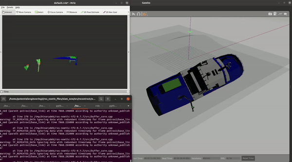

# Underwater Structural Reconstruction and Object Detection Stack for POTROV

This repository serves as the official update stack for clients using **POTROV**, the custom ROV developed by *Potential Engineering, India*. POTROV is designed for underwater structural inspection and object detection, utilizing manual control for precise navigation. This repository provides the software stack and configuration files required for seamless integration, calibration, and updates.

<div align="center">
  
</div>

<div align="center">
  
</div>


## Key Features

- **Manual Control**: Provides precise navigation through manual joystick control, ideal for maneuvering in complex underwater environments.
- **Multiple Map Output Formats**: Supports exporting 3D maps in various formats (e.g., PLY, OBJ, STL) for versatile post-processing and analysis.
- **Real-time Object Detection**: Integrated object detection module using sonar data and video feed for immediate feedback and enhanced situational awareness.
- **Enhanced Data Processing**: Optimized pipeline for high-resolution sonar data capture and efficient 3D structural reconstruction.
- **Easy Deployment**: Includes user-friendly configuration files and setup scripts for straightforward installation and updates.

## Stack Compatibility

This software stack is compatible with the following environments:

- **ROS Version**: ROS Noetic
- **Operating System**: Ubuntu 20.04 LTS
- **CUDA Version**: CUDA 12.6 (for enhanced GPU performance)

## Installation Instructions

Follow these steps to download the stack and integrate it into your firmware:

### 1. Install CUDA 12.6

To leverage GPU capabilities, ensure that CUDA 12.6 is installed on your system. You can follow the official installation guide [here](https://developer.nvidia.com/cuda-downloads).

Alternatively, use the commands below for a quick installation:

- ```$ sudo apt update```
- ```$ sudo apt install nvidia-cuda-toolkit```
- ```$ nvcc --version  # Verify the installation```

### 2. Clone the Repository

Navigate to your ROS workspace source directory and clone this repository:

- ```$ cd ~/path_to_your_src/```
- ```$ git clone https://github.com/siddharthumakarthikeyan/Underwater-Reconstruction-using-POTROV.git```

### 3. Build the Workspace

Build the ROS workspace using ```catkin_make```:

- ```$ cd ../```
- ```$ catkin_make```

### 3. Run the script

Run the updated script:

- ```$ source devel/setup.bash```
- ```$ run_reconstruct.sh```


Please refer to the documentation for detailed setup instructions and integration steps.

---

For any issues or inquiries, please contact [Potential Engineering Support](mailto:support@potentialengineering.com).
